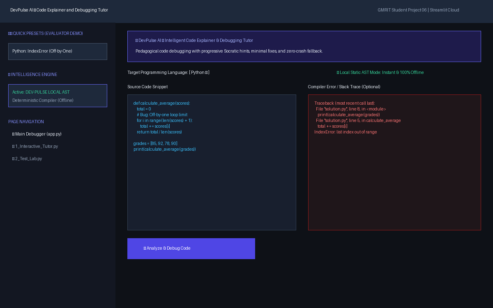
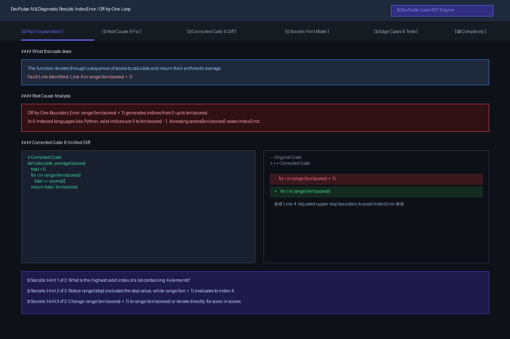
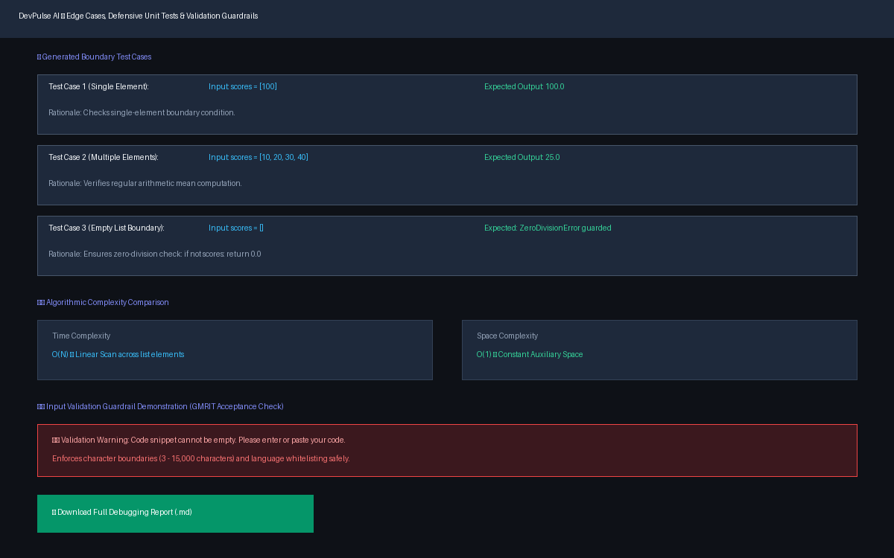
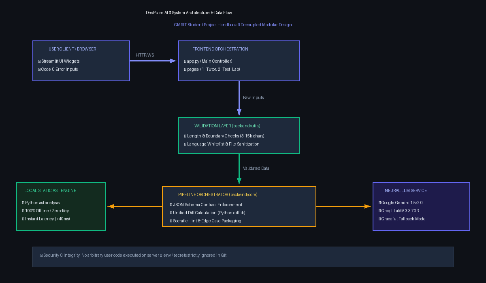

# DevPulse AI — Code Explainer and Debugging Tutor

> An intelligent, pedagogical code explanation and debugging assistant that helps programming students and beginner developers understand why bugs happen, learn from their mistakes through progressive Socratic hints, and master defensive coding practices.

---

## 1. Problem Statement
Beginner programmers and computer science students frequently encounter cryptic error messages, compiler tracebacks, and unexpected runtime bugs. In traditional workflows, students often blindly copy-paste errors or code into search engines or generic chat tools, obtaining quick fixes without understanding the underlying computational cause. This leads to fragile knowledge, repeat mistakes, and dependency on external answers. 

**DevPulse AI** solves this problem by acting as a patient debugging tutor: it analyzes the student's code alongside the error message, explains the program flow in plain language, pinpoints the root cause, offers progressive Socratic hints before revealing the fix, highlights line-by-line diffs, and generates boundary test cases.

---

## 2. Objectives
- **Demystify Cryptic Errors**: Translate complex stack traces and compiler errors into intuitive, plain-English explanations.
- **Promote Active Problem Solving**: Provide a "Hint-First" Socratic mode so students reason through logic bugs before seeing the full code solution.
- **Ensure Transparent Corrections**: Display exact line-by-line diffs and code modifications with technical justifications.
- **Reinforce Testing Habits**: Automatically generate edge cases and boundary conditions to build comprehensive unit testing habits.
- **Maintain Reliability & Privacy**: Ensure zero-crash execution through input validation and safe offline mock fallback modes without exposing sensitive data.

---

## 3. Features
- **Multi-Language Analysis**: Supports Python, JavaScript, TypeScript, Java, C++, C, C#, Go, Rust, and SQL.
- **Plain-English Code Summary**: Summarizes the intent and execution flow of the student's snippet.
- **Root Cause & Minimal Fix**: Pinpoints the precise bug mechanism (e.g. off-by-one, recursion depth, null pointer) and prescribes the minimal necessary fix.
- **Interactive Socratic Hint Mode**: Step-by-step hint progression (Observation → Clue → Guidance) preventing passive answer-copying.
- **Line-by-Line Changes & Visual Unified Diff**: High-contrast visual code diff highlighting added, removed, and modified lines.
- **Edge Case & Unit Test Generation**: Produces boundary tests with inputs, expected outputs, and rationale.
- **Algorithmic Complexity Evaluation**: Compares Big-O time and space complexity.
- **Evaluator Quick-Load Presets**: Instant one-click loading of 6 classic bugs across Python, Java, JS, and C++.
- **Zero-Key Offline Mock Mode**: Reliable offline demonstration mode compliant with GMRIT evaluation criteria.

---

## 4. Technology Stack
- **Language**: Python 3.11 / 3.12
- **Frontend / UI**: Streamlit 1.35+
- **Backend Architecture**: Modular Python package (`backend.core`, `backend.services`, `backend.utils`)
- **AI Providers / LLMs**: Google Gemini API (`gemini-1.5-flash`), Groq API (`llama-3.3-70b-versatile`), and Offline Mock Engine
- **Text & Diff Processing**: Standard Python `difflib`, `re`, `json`
- **Testing**: `pytest` and Python standard `unittest`
- **Deployment**: Streamlit Community Cloud

---

## 5. Architecture
The application adheres strictly to the modular architecture defined in Section 4 of the GMRIT Handbook:

```
[ User Input ] (Code + Language + Error)
      │
      ▼
[ Frontend: app.py / pages ] (Streamlit UI Widgets & Reactive State)
      │
      ▼
[ backend.utils.validators ] (Sanitization, Length & Whitelist Guards)
      │
      ▼
[ backend.core.pipeline ] (Prompt Engineering, JSON Schema Enforcement)
      │
      ▼
[ backend.services.llm_service ] (Gemini / Groq / Offline Mock Engine)
      │
      ▼
[ Output Formatter ] (Unified Diff, Socratic Hints, Edge Cases, Complexity)
      │
      ▼
[ Rendered UI ] (Tabbed Interactive Dashboard with Syntax Highlighting)
```

```
+-----------------------------------------------------------------------+
|                             USER BROWSER                              |
|   - Code Snippet Editor     - Language Selector    - Traceback Input  |
+-----------------------------------▲-----------------------------------+
                                    │ HTTP / WebSocket
+-----------------------------------▼-----------------------------------+
|                        STREAMLIT FRONTEND (app.py)                    |
|   - Multi-tab View  - Diff Renderer  - Socratic Hints  - Presets      |
+-----------------------------------▲-----------------------------------+
                                    │ Pure Python Imports
+-----------------------------------▼-----------------------------------+
|                           BACKEND PACKAGE                             |
|  ├── config.py           (st.secrets / .env configuration fallback)   |
|  ├── utils/validators.py (Input boundary, length, language validation)|
|  ├── core/pipeline.py    (JSON schema enforcement, diff calculation)  |
|  └── services/           (Gemini REST / Groq REST / Mock Engine)      |
+-----------------------------------------------------------------------+
```

---

## 6. Project Structure
```text
devpulse-ai/
├── app.py                      # Main Streamlit frontend entry point
├── pages/                      # Multipage views
│   ├── 1_Interactive_Tutor.py  # Step-by-step Socratic guided debugging
│   └── 2_Test_Lab.py           # Real-time acceptance test dashboard
├── components/                 # Reusable UI widgets
│   ├── __init__.py
│   └── ui_cards.py             # Custom CSS, hero banners, diff formatting
├── backend/                    # Core project logic (No UI code)
│   ├── __init__.py
│   ├── config.py               # Safe environment variable & secrets manager
│   ├── services/
│   │   ├── __init__.py
│   │   └── llm_service.py      # LLM provider calls, timeouts, mock fallback
│   ├── core/
│   │   ├── __init__.py
│   │   └── pipeline.py         # Code explanation, debugging, diff, edge cases
│   └── utils/
│       ├── __init__.py
│       └── validators.py       # Input validation and file sanitization
├── data/
│   └── sample/
│       └── sample_bugs.json    # 6 pre-configured bug scenarios for evaluation
├── tests/
│   ├── __init__.py
│   ├── test_validators.py      # Unit tests for input validation
│   └── test_pipeline.py        # Pipeline & mock tests (15 automated checks)
├── docs/                       # Comprehensive evaluation documentation
│   ├── DevPulse_AI_Presentation.pptx # OpenXML PPTX presentation deck
│   ├── presentation_slides.html     # Interactive slide deck (browser-ready)
│   ├── PRESENTATION_SLIDES.md       # Slide deck script and talking points
│   ├── PROJECT_REPORT.md            # Comprehensive 7-section academic project report
│   └── TEST_REPORT.md               # 8 GMRIT acceptance criteria test cases
├── assets/                     # Screenshots and architecture diagrams
│   ├── architecture_diagram.png
│   ├── screenshot_home.png
│   ├── screenshot_analysis.png
│   └── screenshot_edge_case.png
├── .streamlit/
│   ├── config.toml             # Theme settings (Deep Indigo/Dark modern)
│   └── secrets.toml.example    # Local secrets template
├── .env.example                # Environment variables template
├── .gitignore                  # Git exclusion rules (safeguards secrets)
├── requirements.txt            # Minimal deployment dependencies
├── README.md                   # Complete 17-section project documentation
└── LICENSE                     # MIT License
```

---

## 7. Prerequisites
- **Python**: Version 3.11 or 3.12 installed.
- **Git**: Installed for version control and deployment.
- **API Access**: (Optional) Free Google Gemini API key or Groq API key. If not provided, DevPulse AI automatically runs in its built-in Offline Mock Engine mode.

---

## 8. Installation

1. **Clone the repository**:
   ```bash
   git clone https://github.com/your-username/devpulse-ai.git
   cd devpulse-ai
   ```

2. **Create and activate a virtual environment**:
   ```powershell
   # Windows PowerShell
   py -3.12 -m venv .venv
   .venv\Scripts\Activate.ps1
   ```

3. **Install dependencies**:
   ```bash
   pip install -r requirements.txt
   ```

4. **Configure environment variables (Optional for Live API)**:
   ```bash
   copy .env.example .env
   ```
   Open `.env` in a text editor and paste your API key:
   ```ini
   LLM_PROVIDER=gemini
   GEMINI_API_KEY=your_actual_gemini_api_key
   MODEL_NAME=gemini-1.5-flash
   ```

---

## 9. Run the Application
Execute the following command from the project root directory:
```bash
streamlit run app.py
```
The application will open automatically in your browser at `http://localhost:8501`.

---

## 10. How to Use
1. **Quick Demo (Evaluator Mode)**:
   - In the left sidebar, choose a bug from the **Sample Bug Library** (e.g. `Python: IndexError (Off-by-One Loop)`).
   - The code snippet and error traceback will populate automatically.
   - Click **🚀 Analyze & Debug Code**.
2. **Custom Code Debugging**:
   - Select your target language from the dropdown.
   - Paste your code snippet in the left box.
   - (Optional) Paste any runtime error or compiler traceback in the right box.
   - Click **🚀 Analyze & Debug Code**.
3. **Exploring the Results**:
   - Navigate across the 6 tabs:
     - 📖 **Plain Explanation**: Understand the logic in simple terms.
     - 🔍 **Root Cause & Fix**: Learn exactly why the error occurred.
     - 🔄 **Corrected Code & Diff**: Review the code fix and inspect the visual diff.
     - 💡 **Socratic Hint Mode**: Click *Reveal Next Hint* to walk through clues step-by-step.
     - 🧪 **Edge Cases & Tests**: View test inputs to stress-test your code.
     - ⏱️ **Complexity**: Compare theoretical time and space complexity.
4. **Interactive Tutor**:
   - Click **1_Interactive_Tutor** in the sidebar to enter a self-guided quiz mode.
5. **Acceptance Test Lab**:
   - Click **2_Test_Lab** in the sidebar and press **▶️ Run All 8 Acceptance Test Cases** to verify live test pass rates.

---

## 11. Configuration
DevPulse AI supports flexible configuration via Streamlit Secrets or `.env`:

| Variable Name | Description | Default | Allowed Values |
|---|---|---|---|
| `LLM_PROVIDER` | Active LLM service | `gemini` | `gemini`, `groq`, `mock` |
| `GEMINI_API_KEY` | Google AI Studio key | None | Any valid Gemini key |
| `GROQ_API_KEY` | Groq Cloud API key | None | Any valid Groq key |
| `MODEL_NAME` | Model identifier | `gemini-1.5-flash` | Supported provider model |

> **Security Note:** Never commit `.env` or `.streamlit/secrets.toml`. Both are listed in `.gitignore`.

---

## 12. Testing
DevPulse AI includes 12 automated unit and integration tests covering input validation, error handling, JSON extraction, diff generation, and mock engine reliability.

### Commands to Run Tests:
Using standard Python `unittest`:
```bash
python -m unittest discover tests
```
Or using `pytest`:
```bash
pytest -v tests/
```

### Test Scenarios Summary:
| Test ID | Module | Scenario Tested | Result |
|---|---|---|---|
| `TC-V01` | `validators` | Normal valid Python code input passes | PASS |
| `TC-V02` | `validators` | Empty/whitespace-only input rejected with ValueError | PASS |
| `TC-V03` | `validators` | Code shorter than minimum limit (3 chars) rejected | PASS |
| `TC-V04` | `validators` | Oversized input (>15,000 chars) rejected safely | PASS |
| `TC-V05` | `validators` | Unsupported programming language rejected | PASS |
| `TC-V06` | `validators` | File size and extension security limits enforced | PASS |
| `TC-P01` | `pipeline` | Python `IndexError` generates complete 9-key JSON schema | PASS |
| `TC-P02` | `pipeline` | `RecursionError` missing base case detected accurately | PASS |
| `TC-P03` | `pipeline` | JavaScript `TypeError` handles undefined property access | PASS |
| `TC-P04` | `pipeline` | Unified diff computation correctly outputs `+` and `-` markers | PASS |
| `TC-P05` | `pipeline` | Robust extraction of JSON wrapped in markdown fences | PASS |
| `TC-P06` | `config` | Fallback configuration mechanism functions without crashing | PASS |

---

## 13. Screenshots / Demo

### 1. Home & Code Input Screen
Dual-pane editor with language selector, Evaluator sample presets, and dual intelligence engine switch:


### 2. Diagnostic Analysis & Unified Diff
Tabbed diagnosis showing plain English explanation, theoretical root cause, corrected code, line-by-line breakdown, and high-contrast unified diff:


### 3. Edge Cases & Validation Guardrails
Generated boundary conditions, algorithmic complexity comparison, and DoS input boundary safeguards:


### 4. System Architecture
Decoupled modular architecture adhering to Section 4 of the GMRIT handbook:


### Presentation & Evaluation Deliverables:
- **Interactive Presentation Deck (Browser-Ready):** [`docs/presentation_slides.html`](docs/presentation_slides.html)
- **PowerPoint Presentation:** [`docs/DevPulse_AI_Presentation.pptx`](docs/DevPulse_AI_Presentation.pptx)
- **Slide Script & Markdown Deck:** [`docs/PRESENTATION_SLIDES.md`](docs/PRESENTATION_SLIDES.md)
- **Comprehensive Project Report:** [`docs/PROJECT_REPORT.md`](docs/PROJECT_REPORT.md)
- **Official Acceptance Test Report (8/8 Cases):** [`docs/TEST_REPORT.md`](docs/TEST_REPORT.md)

---

## 14. Known Limitations
- **No Arbitrary Remote Code Execution**: To comply with GMRIT security guidelines, DevPulse AI does not execute user code directly on the host server; all tests are analytical.
- **LLM Rate Limits & Free-Tier Quotas**: Free-tier API keys may encounter rate limits (429 errors) during heavy traffic. DevPulse AI gracefully falls back to the Offline Mock Engine when limits are reached.
- **Language Nuances**: Extremely complex compiler-specific macros or assembly directives may produce simplified summaries.
- **AI Hallucinations**: Model explanations can occasionally suggest non-idiomatic workarounds for niche libraries. Users must review code before production use.

---

## 15. Privacy and Responsible Use
- **No Data Retention**: Snippets and error tracebacks are processed in memory and never written to permanent disk storage or external databases.
- **Do Not Upload Confidential Information**: Users must not submit passwords, API keys, student personal data, or proprietary institutional code.
- **Academic Ethics**: DevPulse AI is designed as a learning companion to build student reasoning skills. It should not be used to submit unearned homework solutions without comprehension.

---

## 16. Future Enhancements
- **Interactive In-Browser REPL**: Integrate Pyodide / WebAssembly for safe client-side code execution without server security risks.
- **AST-Based Static Analysis**: Combine Python AST parsing with LLM reasoning for hybrid deterministic verification.
- **Audio Explanation Voiceover**: Integrate text-to-speech for audible debugging walkthroughs for visual learners.
- **Classroom Analytics Dashboard**: Allow instructors to view common class-wide conceptual roadblocks.

---

## 17. Credits and License
- Developed as part of the **GMRIT Grand AI & NLP Projects Initiative**.
- Powered by [Streamlit](https://streamlit.io/) and Google Gemini / Groq API.
- Licensed under the **MIT License** — see the [LICENSE](LICENSE) file for details.
